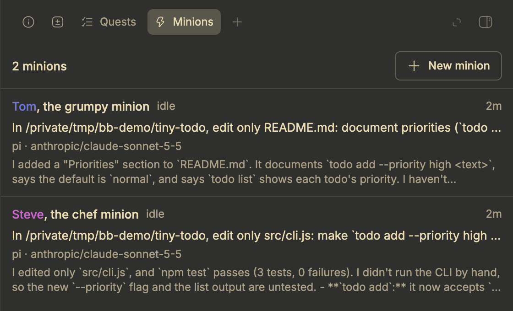
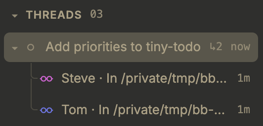

# pi-minions

Delegate work to minions: helper agents that a coding agent starts, follows and stops. pi-minions runs in two places:

- In [bb](https://getbb.app), every thread can spawn minions as child threads, whichever agent provider runs it: pi, Claude Code, Codex, or an ACP agent such as Cursor or opencode. Minions run in the background and report back on their own.
- In [pi](https://github.com/badlogic/pi-mono/tree/main/packages/coding-agent), minions are foreground sessions that stream their progress into the parent session.

Both read the same [personas](docs/agents.md): reusable minion configurations in Markdown files.

## In bb

This repository is also a bb plugin. Install it from Git, or from a local checkout after running `npm ci --ignore-scripts` in it:

```text
bb plugin install git:https://github.com/kalindudc/minions
bb plugin install path:/path/to/minions
```

Do not install it from npm: the npm package contains only the pi extension, so `bb plugin install npm:pi-minions` would find no bb entry files. If you also use pi, update pi-minions in pi to the same version first: pi-minions 0.19.0 and earlier register tools with the same names as the plugin, and pi refuses to start a bb thread that loads both.

Every bb thread then gets:

- the [bb minion tools](docs/reference.md#bb-tools) `spawn`, `list_agents`, `list_minions`, `show_minion` and `halt`, whichever provider runs the thread;
- minions as child threads nested under the thread that spawned them. `spawn` returns at once, and bb reports each minion's answer to its parent when it finishes, fails or needs help;
- a name, a colour and a personality for every minion, so you can tell them apart while they work;
- a [Minions tab](docs/reference.md#minions-tab) in the thread's side panel, where you can follow each minion, open its thread, message it, stop it, archive it or start a new one;
- a `[oo]` button in the prompt box that shows the running, waiting, done and failed counts on hover and opens the Minions tab;
- a goggles icon in each minion's colour on its row in bb's sidebar.



![The [oo] button in the prompt box, showing the minion counts on hover](docs/assets/bb_minions_button.png)



A minion runs on its persona's provider and model, or on its parent's, so one thread can hand work to another provider. Personas can also choose a reasoning level, a permission mode, a separate Git worktree, and whether the minion may spawn minions of its own; see [bb persona fields](docs/agents.md#bb-persona-fields). With the [pi-quests](https://github.com/kalindudc/quests) bb plugin installed, the Minions tab and `list_minions` also show each minion's quest progress.

In bb's pi threads, pi-minions [hands its minion tools to the plugin](docs/reference.md#pi-inside-bb), so the agent sees one set of tools. Plain pi and pi under Herdr keep the foreground minions described below.

## In pi

```bash
pi install npm:pi-minions
```

- Foreground [`spawn`](docs/reference.md#spawn) via `tasks` for single minions or parallel batches
- Named agent discovery from pi/agents and minions directories
- Ephemeral built-in minions when no agent is specified
- `halt` for aborting running foreground minions
- `list_minions` and `show_minion` for current session visibility
- `/minions` and `/minions show <id|name>` for live activity viewing
- `learn_minions`, `/minions learn`, and `/minions skill` for built-in usage guidance

In pi, the parent waits for its minions. Background minions, live detaching, and user steering commands are not part of the public surface.

### Quick start

```text
/spawn Summarize the test failures in this repository
/spawn Inspect src/tools and report risks --model claude-haiku
/minions
/minions show kevin
/minions learn
/halt kevin
```

For LLM-callable tools, use:

```ts
spawn({ tasks: [{ task: "Audit the auth module" }] })
spawn({ tasks: [{ task: "Read src" }, { task: "Read test" }] })
list_agents({})
list_minions({})
show_minion({ target: "kevin" })
halt({ id: "all" })
learn_minions({})
```

### Configuration

The pi extension reads its settings from pi's settings files. The bb plugin reads only persona files.

```json
{
  "pi-minions": {
    "minionNames": ["kevin", "stuart", "bob"],
    "allowEphemeral": true,
    "display": {
      "outputPreviewLines": 20,
      "observabilityLines": 6,
      "showStatusHints": true,
      "spinnerFrames": ["[oo]", "[o-]", "[--]", "[-o]"]
    },
    "toolSync": {
      "enabled": true,
      "maxWait": 5
    }
  }
}
```

## Develop

Install the dependencies with `npm install`. It also runs `prepare`, which checks the toolchain and sets this repository's git hooks. Then:

- Run `bb plugin install path:$PWD` once, then `bb plugin dev $PWD` while you work. It rebuilds and reloads the plugin on every save anywhere in the repository except `dist/`, `node_modules/` and `.git/`, so saves under `tmp/` count too. Without it, `bb plugin reload pi-minions` rebuilds from the current files.
- bb applies tool and instruction changes only when a thread starts a new provider session, so test those changes in a new thread.
- pi sessions started in this checkout load `extensions/pi/` from the working tree, through `.pi/settings.json`.

See [Contributing](docs/contributing.md) for the checks to run before review.

## Documentation

- [Getting started](docs/getting-started.md)
- [Patterns](docs/patterns.md)
- [Agents](docs/agents.md)
- [Reference](docs/reference.md)
- [Architecture](docs/architecture.md)
- [Configuration](docs/configuration.md)
- [E2E testing](docs/e2e-testing.md)
- [Contributing](docs/contributing.md)

The npm package ships source plus standard npm always-included files. The `docs/` directory and changelog file are intentionally not included in the published tarball.
